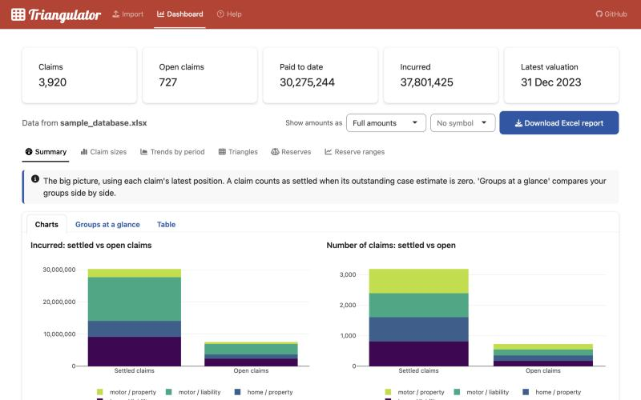
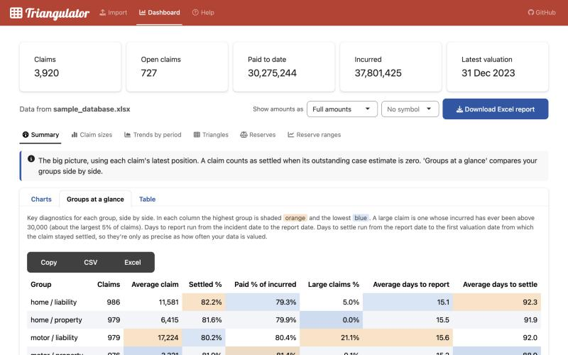

# Triangulator

[](https://github.com/MarkSheridanFSAI/Triangulator_V2/actions/workflows/R-CMD-check.yaml)

**Quick claims analysis, no coding needed.** Upload a claims listing or a set of bordereaux and
Triangulator gives you instant diagnostics: where your claims stand, how groups compare, how
claims develop over time, and a first look at reserves. It's free, and your data stays on your computer.



## Get started in 3 steps

**New to R?** Follow the step-by-step guide: **[Getting started on a new computer](GETTING_STARTED.md)**
(about 15 minutes, no coding experience needed).

Already have R and RStudio (or Positron)? Copy these lines into the **Console** and press Enter after each one:

1. Install the installer (once):
   ```r
   install.packages("remotes")
   ```
2. Install Triangulator (once, and again whenever you want the latest version):
   ```r
   remotes::install_github("MarkSheridanFSAI/Triangulator_V2", upgrade = "never")
   ```
3. Start the app (every time you want to use it):
   ```r
   Triangulator::run_app()
   ```

The app opens in your web browser. Click **Try it with sample data** to look around straight away.
To stop it, close the browser tab and press **Esc** in the Console.

## What you can do

| | |
|---|---|
| **Import** | Upload Excel or CSV. Triangulator recognises common column names (including typical bordereau headings), checks your data and shows the exact rows that need attention. |
| **Summary** | Paid, outstanding and incurred, open and settled claims, average claim sizes. **Groups at a glance** compares groups side by side, including days to report and days to settle. |
| **Claim sizes** | How many claims fall into each size band, to spot large losses. |
| **Trends by period** | Compare periods, e.g. is the average claim getting bigger? Compare any group with the whole book. |
| **Triangles** | See how claims developed over time as a heatmap or table. Click into any cell to see which claims moved, and into any claim's full history. Compare development patterns across groups. |
| **Reserves** | A first-look estimate of what claims will finally cost, split into paid, case reserves, IBNER, IBNR and unexpired risk. |
| **Reserve ranges** | How uncertain that estimate is (Mack's method): standard error, percentiles and a chart of likely outcomes. |
| **Excel report** | Everything in one workbook, with one click. |

Amounts can be shown in full, in thousands or in millions, with a £, € or $ symbol. Every table has
Copy, CSV and Excel buttons. Charts can be zoomed and downloaded.



## Your data file

One row per claim, with:

| Needed | Optional |
|---|---|
| Claim ID | Policy ID |
| Valuation date (the date of the bordereau or listing) | Policy start date (needed for underwriting views and unexpired risk) |
| Incident (loss) date | Grouping columns, e.g. class of business or region |
| Report (notification) date | |
| Paid to date | |
| Outstanding reserve | |

- **One bordereau** (one valuation date) gives you the summary, claim sizes, groups at a glance and trends.
- **Several bordereaux combined** (each claim appearing once per month or quarter, with a column for the
  bordereau date) also gives you triangles, development patterns and reserve estimates.
- Dates can be real Excel dates or text such as `2024-01-31` or `31/01/2024` (read as day/month/year).
- Excel (.xlsx, .xls) or CSV, up to 100 MB.

See the [sample data](inst/app/www/sample_database.xlsx) for an example layout.

## Privacy

When you run Triangulator on your own computer, your file never leaves it. Nothing is saved after you
close the app, apart from files you choose to download.

## Please note

Triangulator is a companion for exploring claims data. The reserve figures are automatic first
estimates and must not be relied on for booking reserves. Use at your own risk.

## Questions, bugs and ideas

Please use the [Issues](https://github.com/MarkSheridanFSAI/Triangulator_V2/issues) tab. If something
goes wrong, the R Console shows a time-stamped line for each step, which helps pinpoint the problem.

---

## For developers

<details>
<summary>Project layout, tests and how to run from source</summary>

Triangulator is an R package containing a Shiny app.

| Path | What it is |
|---|---|
| `R/app.R` | Page layout, server logic and `run_app()` |
| `R/prepare.R`, `R/checks.R` | Reading files, matching columns, data checks |
| `R/triangles.R` | Building triangles and claim movements |
| `R/reserves.R`, `R/ranges.R` | Chain-ladder reserves and Mack reserve ranges |
| `R/compare.R`, `R/overviews.R` | Group comparisons and summaries |
| `R/plots.R` | Charts |
| `R/mod_*.R` | The individual pages and tabs |
| `R/export.R` | The Excel report |
| `inst/app/www/` | Sample data and sample column mapping |
| `tests/testthat/` | Automated tests |

- **Install what's needed for development:** `install.packages(c("remotes", "pkgload", "testthat")); remotes::install_deps()`
- **Run the app from the source code:** open `launch_app.R` and click **Source**.
- **Run the tests:** open `run_tests.R` and click **Source**. They check the calculations against
  hand-worked examples, against results saved from the original V1.1 app, and against the published
  results for the standard RAA example used in reserving textbooks.
- Every push to GitHub runs `R CMD check` on Windows, macOS and Linux (see the badge at the top).

</details>

## Licence

MIT: free to use, change and share, including commercially, as long as the copyright notice is kept.
See [LICENSE.md](LICENSE.md).
